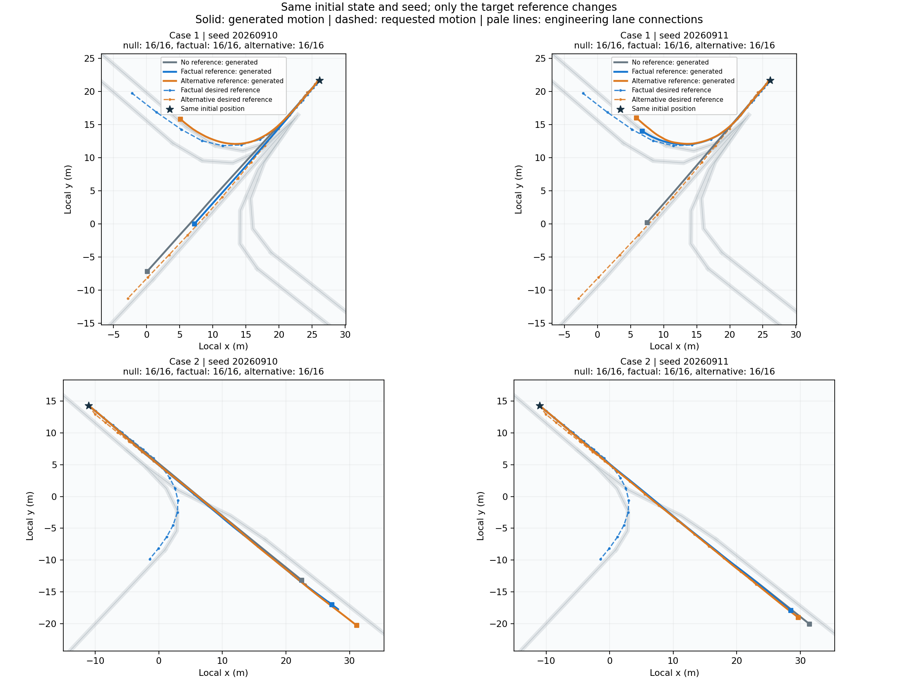

## Research Goal

Traffic simulation is useful for asking how a change in routing or demand affects an interacting population. A generated scene needs to respond to those changes while preserving plausible movement, waiting, and interaction. Reaching a requested exit is only one part of that problem.

I am developing a research system that connects **route-conditioned traffic generation** with **intent-aware task allocation**. The central questions are whether a model can execute a specified map route in a closed loop, and whether a shared routing objective can be achieved by assigning tasks that require fewer changes to participants' existing movement tendencies.

## What I Am Developing

- **Route conditioning and joint fine-tuning.** An ordered map path provides a spatial route condition. A route encoder and feature-wise conditioning branch are trained together with the SMART motion decoder. The condition leaves timing and intermediate motion to the generated interaction.
- **Recorded-scene execution.** Scene adapters initialize the participant group from observed history and provide current recorded signal states. A rolling-history execution kernel supports sampling, task termination, and reproducible evaluation.
- **Intent-aware allocation.** An independent offline module assigns participants to routes under feasibility and quota constraints, prioritizing fewer reassignments from an explicitly supplied baseline. Historical motion, lane compatibility, and uncontrolled predictions are being examined as evidence for that baseline.
- **Inspectable experiments.** Saved trajectories and model identities support comparisons between uncontrolled motion, an original route or reference, and an alternative condition. Successful, incomplete, and degraded outcomes remain visible in the evaluation.

The system builds on the open-source **SMART** and **CAT-K** traffic modeling foundations. My work adds the route-conditioning, scene adaptation, allocation, and experimental workflow described here. Earlier conditioning prototypes drew on the encoder and FiLM structure of **ECoSim**; the current training procedure is developed separately.

## Prototype and Current Work

Earlier prototypes produced saved three-way replays using the same initial scene and random seed while changing only the target participant's timed reference. These replays help inspect whether motion changes with the condition, including how surrounding participants respond. Their reference-following errors describe those historical experiments.

The current research uses **map routes without prescribed arrival times** and joint fine-tuning of route conditioning and motion generation. Route completion, preservation of already compatible behavior, and interaction quality are evaluated separately. Training and evaluation are ongoing; stable route control has yet to be established. The offline allocation module is implemented, with integration contingent on a validated route executor.

## Evaluation

The experimental comparisons address three connected questions:

- **Does the requested route execute?** Measure the actual first exit and distinguish correct completion, wrong exits, and unfinished trajectories. Report original-route and changed-route tasks separately.
- **What changes in behavior?** Compare conditioned and uncontrolled outcomes under matched initial scenes and seeds. Inspect curb crossings, wrong-way motion, and participant overlap as explicit quality proxies alongside route success.
- **Does allocation reduce intervention?** Compare actual achieved route counts, reassignment and intervention counts, motion-quality changes, and computational cost. Planned assignments and completed movements are recorded separately.

The longer-term objective is to connect aggregate routing targets with measured changes in individual behavior, while preserving the uncertainty in inferred movement intent.
